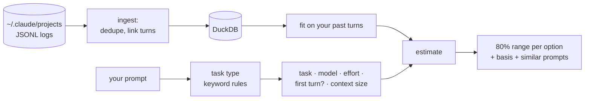

# tokcast

[](https://github.com/arslanmmmm/tokcast/actions/workflows/ci.yml)


**A forecast for your tokens.** tokcast predicts how many tokens a Claude Code prompt will
use *before* you send it, for different models and effort levels, learned from your own
history and computed entirely on your machine.

> 🎬 *Demo GIF coming soon.* Record it with [vhs](https://github.com/charmbracelet/vhs):
> `vhs docs/demo.tape`

```console
$ tokcast predict "fix the login bug in auth.py" --model opus --effort high
╭─ tokcast predict ──────────────────────────────────────────────────────────────╮
│ Task: bugfix  (matched "fix", "bug")                                           │
│ Context: new chat ≈ 60.1k tokens (median of your 300 first turns) + prompt ≈ 7 │
╰────────────────────────────────────────────────────────────────────────────────╯
Estimated tokens for this turn (80% range, median)
   model   effort     processed  median  written by model  basis
▶  opus    high    94.1k – 1.3M    294k       635 – 13.4k  bugfix turns, n=736
   opus    medium  67.1k – 919k    209k        375 – 7.9k  bugfix turns, n=736
   sonnet  high     109k – 1.5M    341k       659 – 13.9k  bugfix turns, n=736
   haiku   medium  87.6k – 1.2M    273k        355 – 7.5k  bugfix turns, n=736
Adjustments: high effort x1.40 vs medium (770 turns + assumption); ...

Similar past prompts
  "fix the login bug in auth.py" → 1.2M (haiku·medium, Aug 28)
  "fix the login bug in auth.py" → 447k (sonnet·xhigh, Jul 29)
```

<sub>All sample output in this README comes from synthetic demo data (`tokcast synth`), never
from real logs.</sub>

## Why

Tools like [ccusage](https://github.com/ccusage/ccusage) show what you *already* spent.
tokcast looks forward. Building it showed where Claude Code's cost actually comes from:

- **Re-reading, not writing.** Every API call re-reads the whole conversation. In the
  author's logs, **98% of tokens processed were cache reads**; Claude wrote only 0.4%.
- **One prompt, many calls.** One prompt often sets off a tool loop: in the author's logs, a
  single prompt led to 55 API calls and 11 million tokens processed.
- **Context size dominates.** The same prompt costs several times more in a 300k-token
  conversation than in a fresh chat.

So tokcast predicts the **whole turn** (every tool call and subagent), as a **range**, with
the conversation's size built in. A single number would pretend to a precision nobody has.

## Install

tokcast isn't on PyPI yet. Install it from GitHub with [uv](https://docs.astral.sh/uv/):

```bash
uv tool install git+https://github.com/arslanmmmm/tokcast
```

Or run it without installing:

```bash
uvx --from git+https://github.com/arslanmmmm/tokcast tokcast --help
```

Optional quantile regression (adds scikit-learn, ~100 MB):
`uv tool install "tokcast[ml] @ git+https://github.com/arslanmmmm/tokcast"`.

## Quick start

```bash
tokcast ingest                       # read ~/.claude/projects into a local database
tokcast stats                        # what your history looks like
tokcast predict "refactor the auth module to use JWT" --model opus --effort high
tokcast predict "go on with step 2" --continue   # in your current conversation
tokcast eval                         # how accurate are the ranges on your history?
```

No logs yet? Try everything on realistic synthetic data. It goes into a separate
database, never mixed with yours:

```bash
tokcast synth --out tokcast-demo
TOKCAST_HOME=tokcast-demo/db tokcast ingest --path tokcast-demo/logs
TOKCAST_HOME=tokcast-demo/db tokcast predict "fix the login bug"
```

## Commands

| command | what it does |
|---|---|
| `tokcast ingest` | Loads Claude Code session logs into a local DuckDB file. Incremental and append-only: re-running adds only new data and never loses history, even when Claude Code rewrites or deletes old logs. |
| `tokcast stats` | Tokens by model and effort, day and project, the most expensive sessions, and how cost grows with conversation length. Includes a data-quality check per Claude Code version. |
| `tokcast predict "<prompt>"` | Predicted range for the next turn. Options: `--model`, `--effort`, `--context 120k` or `--continue`, `--no-compare`, `--json`, `-` for stdin. |
| `tokcast eval` | Walk-forward backtest on your history against four simpler methods. `--synthetic 300` to try it on generated data, `--markdown` for a table. |
| `tokcast calibrate --used 23` | Records the usage % from Claude's usage screen; after 3 readings, `predict` shows "% of 5h limit" (estimates). |
| `tokcast statusline` | Optional Claude Code status-line command that records official usage readings automatically (Pro/Max). See `--setup`. |
| `tokcast synth` | Generates realistic, clearly marked synthetic logs for demos and tests. |

Every report command has `--json`, so other tools can use the same data.

## In Claude Code: tokcast-buddy

The same predictions without leaving Claude Code. [tokcast-buddy](integrations/claude-code/)
is a Claude Code mod: a small character in the band above the prompt box, in the terminal
and the desktop app. Type a prompt, click **How much will this cost?**, and it answers
before you send:

```
(•o•) [ How much will this cost? ] [ × ]
  ~552k tokens (183k–2.5M) for a bugfix turn
  5h limit: 24% used now → this turn ≈ +3% (1%–9%)
  weekly limit: 41% used now → this turn: learning your limit (1/3 readings)
  basis: 518 of your bugfix turns · this conversation: 120k tokens of context so far
  tip: in a new chat this would be ~300k tokens
```

- **It prices your draft in the conversation you're in.** The mod passes the live context
  size, model and effort to `tokcast predict`, so a follow-up in a long chat isn't priced
  like a new one.
- **"% used now" is Claude Code's own figure** for the 5-hour and weekly windows. What the
  turn would *add* is learned (see [calibration](docs/calibration.md)). The mod collects
  the readings for that itself after every turn, so no status-line setup is needed.
- **It runs tokcast locally** (the draft goes to it on stdin) and only when you click,
  because each run starts Python and DuckDB.

```bash
uv tool install --editable .                    # puts `tokcast` on your PATH
claude --plugin-dir integrations/claude-code    # loads the mod for this session
```

Options, tests and design notes are in the [mod's README](integrations/claude-code/README.md).

## How prediction works



1. **Cost = re-reads × context.** For a past turn, tokcast learns how many times it re-read
   its context (`total / context before`). A new estimate multiplies that by the context
   you're about to send.
2. **Effort, model and "first turn of a session" are multipliers.** They're learned from
   your history and **shrunk toward built-in assumptions** when data is thin. With 2
   examples the assumption dominates, with 200 your data does.
3. **The range comes from your own turns of the same task type** (bugfix, refactor,
   explain, ...), falling back to all turns, then to labelled assumptions.
4. **Every estimate shows its basis:** the group and sample size, and which multipliers are
   *assumed* rather than learned.

The details, including two modelling bugs found along the way, are in
[docs/how-prediction-works.md](docs/how-prediction-works.md).

## Accuracy

`tokcast eval` runs a **walk-forward backtest**: the newest half of your turns is predicted
in 5 folds, each by a model trained only on *older* turns. A random split would leak the
future into training. Methods are compared on the same turns with a **paired** difference
in pinball loss (95% interval).

**Synthetic data**, 1,420 test turns (`tokcast eval --synthetic 300`):

| method | in 80% range | within 2x | bias | width | pinball loss | vs baseline (95% CI) |
|---|---|---|---|---|---|---|
| global median | 80% ±2 | 37% | x1.03 | x35 | 0.332 | +0.126 [+0.115, +0.136] |
| single call (ctok-style) | 30% ±2 | 30% | x0.33 | x1 | 0.629 | +0.422 [+0.395, +0.449] |
| context x re-reads | 79% ±2 | 37% | x1.00 | x19 | 0.289 | +0.083 [+0.074, +0.091] |
| assumptions only | 80% ±2 | 60% | x1.19 | x10 | 0.231 | +0.024 [+0.019, +0.029] |
| **tokcast baseline** | **80% ±2** | **63%** | **x1.00** | x11 | **0.207** | |
| quantile regression (linear) | 79% ±2 | 62% | x1.00 | x10 | 0.201 | -0.006 [-0.008, -0.003] |

How to read it:
- The baseline is **calibrated**: 80% of actual turns fell inside its 80% range.
- It is unbiased, and it beats every simple method.
- A single-call estimate, which ignores the tool loop, misses 70% of turns.

Synthetic data proves the machinery, not real-world accuracy. The generator shares the
built-in assumptions, which is why "assumptions only" does so well.

**Real history** (the author's, 26 test turns): the ranges covered 62% of turns, against 81%
for the simpler "context × re-reads". With 26 turns, coverage is only known to ±19 points.
A diagnosis found a **distribution shift**: training was short Q&A in one project, testing
was long agentic work in another. The model was deliberately *not* tuned on those 26
turns; that would overfit the test set. Run `tokcast eval` on your own history to see your
numbers.

**Linear quantile regression** was tested as a challenger (`--method qreg`). It is 3%
better on synthetic data, but that data structurally favours it, and it can't be tested on
small real histories yet. So the simpler baseline remains the default.
[Why](docs/how-prediction-works.md#challenger-quantile-regression-and-why-the-baseline-stayed).

## Privacy

- **Nothing leaves your machine.** No network calls, no telemetry, no API key. A test runs
  the full ingest with network sockets disabled.
- Logs are only read. tokcast writes to its own database
  (`~/.local/share/tokcast/tokcast.duckdb`, or `$TOKCAST_HOME`).
- Prompt text is stored locally, so prompts can be re-classified when the rules improve.
  `tokcast ingest --no-text` keeps only each prompt's length and a hash.
- Synthetic data is refused by the real database unless you point `TOKCAST_HOME` elsewhere.
- tokcast never edits your Claude Code settings; `statusline --setup` prints the snippet
  for you to add.
- The Claude Code mod sends your draft only to the local `tokcast` process. After each
  turn it saves the usage reading and runs `tokcast ingest` (turn off with its
  `autoIngest` option); a separate `TOKCAST_HOME` is never auto-ingested.

## Limitations

- **Output length is inherently uncertain.** Ranges are wide on purpose, and an 80% range
  misses one turn in five by design.
- **The usage-% formula isn't public.** tokcast calibrates it per user from your own
  readings and labels the results as estimates. Usage on claude.ai or other machines isn't
  in local logs, so percentages err on the high side. See [docs/calibration.md](docs/calibration.md).
- **Small histories lean on assumptions.** They are labelled wherever they're used, but
  they come from one person's logs (one model, one effort level).
- **Claude Code's log format is undocumented** and changes between versions. The parser is
  tolerant, reports bad lines instead of crashing, and `stats` flags suspicious usage values
  per version.
- **Task types come from keyword rules:** crude, but easy to inspect and fix.
- **Subagent support** follows community reports of the file layout; it isn't verified on
  real subagent logs yet.
- **Claude Code only** for now.
- **The mod's "+x% for this turn" needs 3 readings per window,** so a new user sees only
  "% used now" at first. The weekly window moves slowly, so it can take days.
- **The mod hides while Claude Code shows something else above the prompt** (a question
  box, a survey). Close that box and the character comes back.

## Roadmap

- **Next: a starting guess for "% of limit"** per plan (Pro, Max 5x, Max 20x), labelled
  "assumed" and refined by your readings with the same shrinkage the token model uses,
  so new users see a percentage from their first prompt. Adopted only if it beats the
  current method on held-out readings.
- **v2: browser extension for claude.ai**, showing a live estimate under the input box.
  `predict --json` and the `Predictor` interface are already the API it needs.
- **v3: suggestions**, e.g. "Sonnet is enough for this" or "you have ~12% left; this
  needs ~10%". The first two exist already: the new-chat tip and the
  "wouldn't fit in what's left" warning.
- **Other tools** (Codex CLI, Cursor, ...) through the pluggable `LogSource` parser
  interface.
- Model improvements, each to be adopted only if `tokcast eval` shows a real gain:
  - weighting recent turns more (for distribution shift)
  - fitted cost weights for calibration
  - revisiting quantile regression on larger real histories
- A PyPI release, so `uvx tokcast` works directly.

## Related projects

tokcast builds on excellent existing tools: [ccusage](https://github.com/ccusage/ccusage)
for reports of past usage, [Claude-Code-Usage-Monitor](https://github.com/Maciek-roboblog/Claude-Code-Usage-Monitor)
for live monitoring and burn rate, and [claumon](https://github.com/fabioconcina/claumon)
for a dashboard with calibrated forecasts of your usage window.

Those tools tell you what you've spent, or where your current 5-hour or weekly window is
heading. tokcast answers a different question: **what will this one prompt cost, before
you send it?** It predicts a range for the whole turn (every tool call the prompt sets
off) from your own history, compares models and effort levels side by side, and
publishes how often its ranges are right via `tokcast eval`.

A detailed comparison, including what users of these tools ask for, is in
[docs/related-work.md](docs/related-work.md).

## Development

```bash
uv sync                                  # Python 3.12, dev tools and the ml extra
uv run pytest                            # 135 tests, about 30 s
uv run ruff check . && uv run ruff format --check .
```

The Claude Code mod has its own tests (`claude plugin test integrations/claude-code`, 28
tests). They need the Claude Code binary, so CI doesn't run them yet.

CI runs the Python checks on every push. Fixture logs in `tests/fixtures/` are handwritten, and
`.gitignore` blocks real logs and databases.

```
src/tokcast/
  ingest/      log sources (pluggable) -> typed records -> append-only bulk load
  storage/     DuckDB connection; SQL schema, views and reports in sql/*.sql
  features/    task classifier, feature table
  predict/     baseline predictor, assumptions, similar prompts, quantile regression
  evaluate/    walk-forward backtest, metrics, reference methods
  calibrate/   usage readings -> % of limit
  capture.py   status-line capture (standard library only, fast)
  synth/       synthetic log generator
  stats/       usage report
  cli.py       Typer commands; render.py: Rich output
integrations/claude-code/   the tokcast-buddy mod (TypeScript)
```

The data model is described in [docs/schema.md](docs/schema.md).

## License

[MIT](LICENSE)
