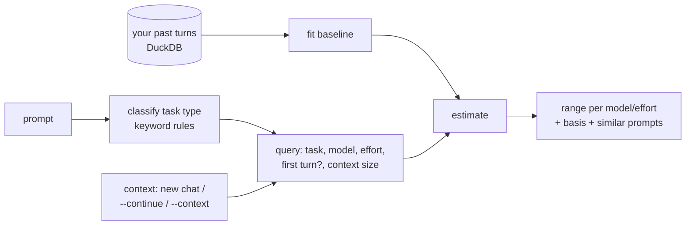

# How prediction works

`tokcast predict` estimates one **turn**: your prompt plus every API call it sets off
(tool calls, subagents) until Claude answers. It reports two ranges, each the 10th to
90th percentile (an 80% range) with a median:

- **tokens processed**: everything the model read or wrote. This is what fills usage
  limits, and it is dominated by re-reading the conversation on every call.
- **tokens written**: what the model produced, including thinking.

## The model, step by step

1. **Cost is calls × context.** Every API call re-reads the whole conversation, so for
   the total the model learns *re-reads*: `total_tokens / context_before`. The estimate
   is then re-reads × the context you're about to send. The same prompt costs far more in
   a 300k-token conversation than in a fresh one, and the model gets that right.

2. **Logs, not raw counts.** Token counts are heavy-tailed: most turns are small, a few
   are huge. On a log scale, a multiplier such as "high effort costs 1.35×" becomes a
   simple shift, and quantiles behave well.

3. **Three effects are multipliers:**
   - *first turn of a session vs. later* (first turns explore the project)
   - *effort* (low … max)
   - *model* (opus, sonnet, haiku, fable)

   Each is estimated from your history as an average shift (mean of log residuals) and
   then **shrunk toward a built-in assumption**: a level seen in *n* turns is weighed
   against 20 pseudo-turns of the assumption. With 2 turns the assumption dominates; with
   200 your data does.

4. **The spread comes from your own turns of the same task type.** A group needs at least
   8 turns; otherwise it falls back to all your turns, and with no usable history to a
   built-in lognormal assumption.

Every estimate says which level it used (`bugfix turns, n=518`, `all turns, n=53` or
`built-in assumption`) and which multipliers are *assumed* rather than learned.

## Task types

Prompts are classified with keyword rules ([classify.py](../src/tokcast/features/classify.py)):
`bugfix`, `tests`, `refactor`, `docs`, `explain` (including questions), `feature`,
`followup` ("go", "continue", "yes"), `shell` (commands typed in the app's terminal) and
`other`. The rule with the most distinct matching words wins; ties go to the rule listed
first. The matched words are shown with every prediction.

## Context

| Option | Context used | First turn? |
|---|---|---|
| *(default)* | a new chat: the median context before your first prompts | yes |
| `--continue` | your most recent conversation, as of the last `tokcast ingest` | no |
| `--context 120k` | the size you give | no |

When continuing a long conversation, tokcast also estimates the same prompt in a new chat
and shows a tip if that would be clearly cheaper. It isn't always: first turns explore more.

## Two lessons from building it

- **Effects use the mean of logs, not the median.** Calls per turn are small whole
  numbers. On synthetic data with a known 1.35× effect for high effort, the median of
  residuals found 1.04× because it barely moves on lumpy data. The mean of logs found
  1.45×. A regression test pins this.
- **"First turn" is a multiplier, not a group.** Splitting groups by first/later turn left
  too few first turns per group, so estimates fell back to "all turns" and forgot that
  first turns cost several times more. As a shrunk multiplier, the effect survives even
  with two examples.

## Limitations

- Output length is inherently uncertain; ranges are wide on purpose.
- The built-in assumptions come from one person's logs (one model, one effort level).
  They are labelled "assumed" wherever they're used.
- Keyword classification is crude. It is easy to inspect and fix, which matters more here
  than squeezing out accuracy.
- How well the ranges actually work is measured by `tokcast eval` (backtest on your own
  history), not assumed.
