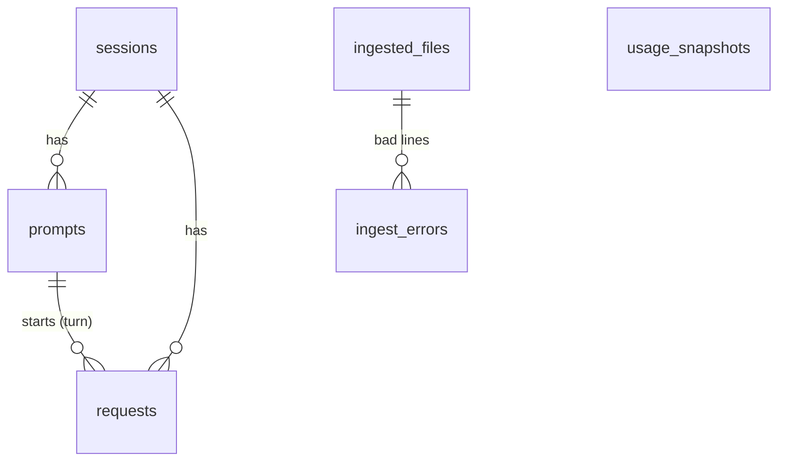

# Data model

tokcast keeps everything in one local DuckDB file. The schema is plain SQL in
[`src/tokcast/storage/sql/`](../src/tokcast/storage/sql/); reports and model inputs are SQL
files too.

## Tables

| table | one row per | key | notes |
|---|---|---|---|
| `ingested_files` | log file | `path` | size and mtime; unchanged files are skipped on the next run |
| `ingest_errors` | unreadable line | (file, line) | replaced on each re-read: describes the file as it is now |
| `sessions` | Claude Code session | `session_id` | project = last folder of `cwd` |
| `prompts` | human prompt (a turn) | `prompt_id` | text (or only length and hash with `--no-text`), `kind` (`text`, `bash-input`, ...) |
| `requests` | API call, deduplicated | `request_id` | token counts by type, model, effort, tools, `agent_id` for subagents |
| `usage_snapshots` | usage-limit reading | (window, resets_at, %) | from the status line or `calibrate --used` |

**Loading is append-only.** Rows are upserted by id and never deleted when they disappear
from a log file. Claude Code rewrites logs on resume and compact, and deletes them after
30 days, so the database, not the files, is the durable record. Token counts only grow
(`greatest`): a request first seen half-written gets its final numbers later, but a
rewritten file can never shrink them. A changed file is loaded in one transaction.

## Views

| view | what it adds |
|---|---|
| `v_requests` | per call: `context_tokens`, `total_tokens`, `weighted_tokens` (price-ratio weights), `model_family`, `quality_flag`, and `turn_id`. Subagent calls get their turn through an `ASOF JOIN`: the latest prompt in the same session at or before the call. |
| `turns` | per prompt: number of calls and tool calls, context before the turn, output, total and weighted tokens, subagent share, turn index in the session |

## Definitions

- **tokens processed** (`total_tokens`) = input + cache write + cache read + output. This
  is what fills usage limits and what `predict` forecasts.
- **context before a turn** = what the turn's first main-agent call read
  (input + cache write + cache read).
- **weighted tokens** = input + 1.25 × cache write (5 min) + 2 × cache write (1 h) +
  0.1 × cache read + 5 × output: an assumption that limits weigh tokens the way API prices
  do (see [calibration.md](calibration.md)).

## Facts about the log format the parser relies on

Verified on real logs (Claude Code 2.1.x). Each one is also covered by a fixture test:

1. **One API response is split into one line per content block** (thinking, text,
   tool_use), and each line repeats the usage. Lines are merged by `requestId` (fallback:
   `message.id`), keeping the **max** of each count. Summing would count each call 2–3
   times.
2. **A turn starts with a `user` line where `turnOrigin == "human"`**, with a fallback rule
   for older versions. Tool results are `user` lines too, but continue the turn.
3. **Assistant lines carry no prompt id.** They are linked by walking `parentUuid` up to the
   nearest user line, with file order as a fallback.
4. **Timestamps can go backwards** between neighbouring lines, so ordering uses line
   numbers.
5. **The desktop app can prepend `<system-reminder>` blocks** to a message. They are
   stripped from the prompt text.
